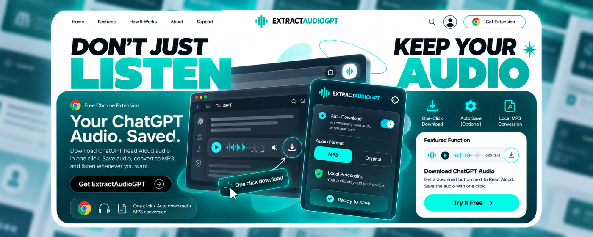
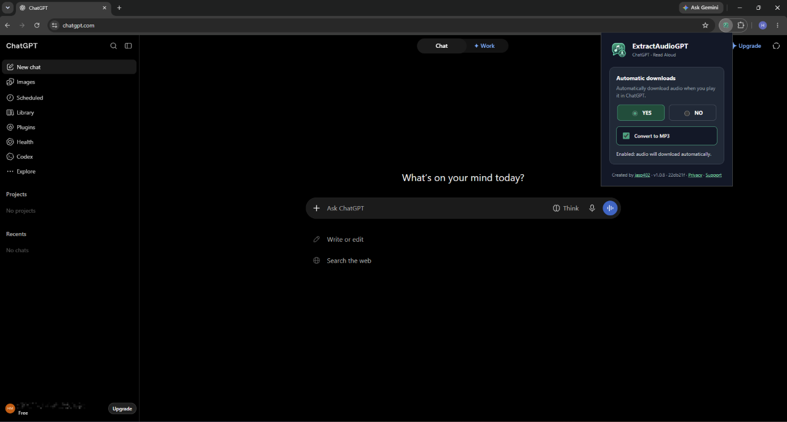
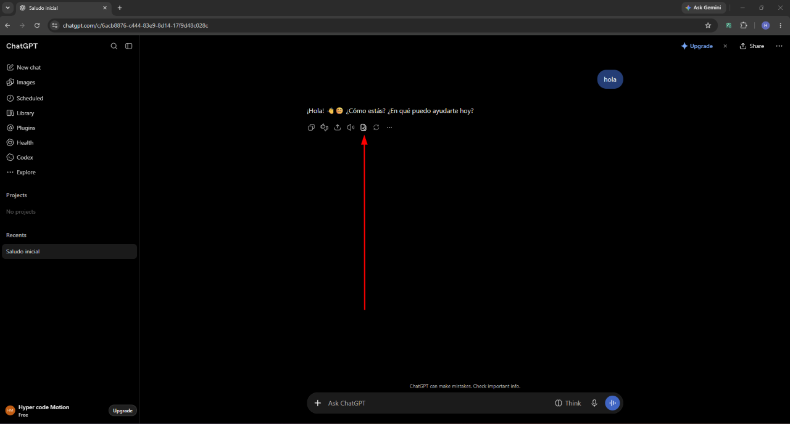
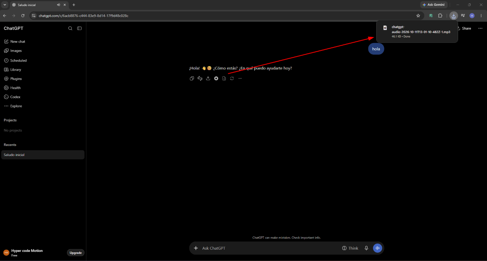
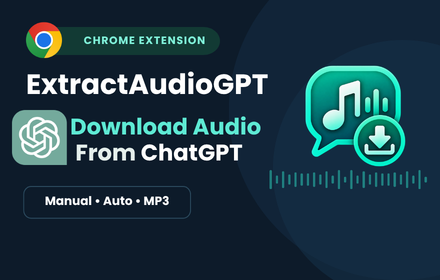

# ExtractAudioGPT

### Don't just listen. Keep it.

**Save ChatGPT Read Aloud audio in one click.** Download a response manually, turn on automatic saving, or convert captured audio to MP3 directly in your browser.

[**Download the latest release →**](https://github.com/jasp402/ExtractAudioGPT/releases) · [**Report an issue**](https://github.com/jasp402/ExtractAudioGPT/issues/new/choose) · [**Privacy policy**](PRIVACY.md)

## Your ChatGPT audio. Saved.

ChatGPT can read responses aloud. **ExtractAudioGPT makes it easier to keep those recordings**—without screen recording, separate audio capture tools, or external conversion services.

| One-click download | Automatic saving | Optional MP3 | Local processing |
| :--- | :--- | :--- | :--- |
| Save audio using the download control beside a ChatGPT response. | Turn on automatic downloads when Read Aloud audio is captured. | Convert captured audio to MP3 in your browser. | Audio is processed locally, not uploaded to developer-operated servers. |

> **Independent extension:** ExtractAudioGPT is not affiliated with, endorsed by, or sponsored by OpenAI.

## See it in action

These screenshots show the real extension interface and the download workflow.

### 1. Set your preferences

Use the extension popup to enable or disable **Automatic downloads**. Check **Convert to MP3** if you prefer MP3 files. You can still download audio manually when automatic downloads are disabled.

### 2. Save audio from a ChatGPT response

Open a ChatGPT conversation, find the response you want to keep, and click the **Download audio** icon in its action bar. ChatGPT's interface can differ between browsers and sessions.

### 3. Find your downloaded file

Your browser saves the audio to **Downloads/ExtractAudioGPT**. With MP3 conversion enabled, the file can be saved as an MP3; if conversion fails, the extension attempts to save the original format instead.

## How to install

Until the Chrome Web Store listing is approved, install the test release manually:

1. Download **ExtractAudioGPT.zip** from [GitHub Releases](https://github.com/jasp402/ExtractAudioGPT/releases). **Do not download** GitHub's automatically generated `Source code (zip)` archive.
2. Extract the ZIP into a folder.
3. In Chrome, open `chrome://extensions` and enable **Developer mode**.
4. Select **Load unpacked** and choose the folder containing `manifest.json`.
5. Open [ChatGPT](https://chatgpt.com/), play **Read Aloud**, and use the new download control—or enable automatic downloads in the popup.

## Designed for everyday workflows

**Study and review.** Keep spoken explanations for later listening.

**Create and organize.** Save useful AI narration alongside your projects and notes.

**Stay productive.** Revisit audio without hunting for the same conversation again.

### Privacy by design

Audio processing and optional MP3 conversion run in your browser. The extension does not upload recordings to developer-operated servers. Preferences are saved using `chrome.storage.sync`, which may sync through your browser account. See the [full privacy policy](PRIVACY.md).

---

### Your audio, your files, your workflow.

**One click · Automatic downloads · Optional MP3**

[**Get ExtractAudioGPT →**](https://github.com/jasp402/ExtractAudioGPT/releases) · [**Get support →**](https://github.com/jasp402/ExtractAudioGPT/issues/new/choose)

## Support and status

**Current test release: v1.0.9.** The Chrome Web Store submission is in preparation/review; installation through the store is not yet confirmed. Browser compatibility and ChatGPT interface changes may affect operation.

If something fails, [open an issue](https://github.com/jasp402/ExtractAudioGPT/issues/new/choose) with your extension version, browser version, and reproduction steps. **Never share private conversations, cookies, or session tokens.**

*ExtractAudioGPT is an independent open-source project and is not affiliated with OpenAI.*
